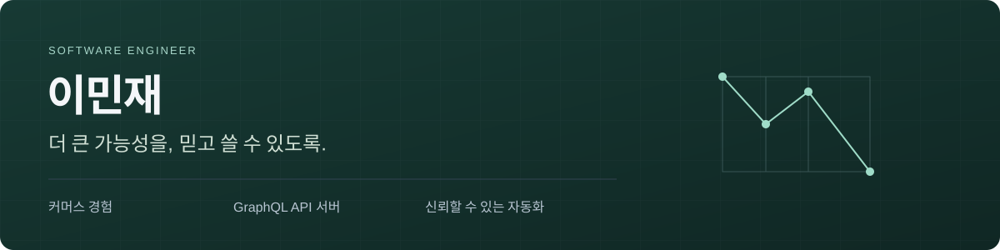

[English](README.md) · [한국어](README.ko.md)

네이버에서 커머스 경험, GraphQL API 서버, 개발 생산성을 다루는 소프트웨어 엔지니어 민재입니다. 큰 아이디어가 사람들이 믿고 쓰는 제품이 되도록, 어려운 엔지니어링 판단을 직접 확인할 수 있는 형태로 만드는 데 관심이 있습니다.

[LinkedIn](https://www.linkedin.com/in/minjae-lee-kr/) · [엔지니어링 글](https://www.linkedin.com/pulse/when-findings-isnt-enough-coverage-heartbeats-lee-minjae-vre0c/)

### 대표 엔지니어링 실험

가상 데이터를 사용하는 독립적인 구현입니다. 실제로 마주할 수 있는 질문을 다루고, 증명할 수 있는 범위를 함께 밝힙니다.

| 작업                  | 핵심 질문                                                            | 근거                                                                                                                                |
| --------------------- | -------------------------------------------------------------------- | ----------------------------------------------------------------------------------------------------------------------------------- |
| **Intent / Recovery** | 응답이 사라진 뒤에도 같은 사용자의 의도로 결과를 복구할 수 있을까?   | 실제 HTTP 응답 유실, SQLite, 프로세스 종료. [기록된 로컬 실행](docs/evidence/intent/).                                              |
| **Verified Change**   | 검토한 코드와 검사 정책이 실제 반영 대상에도 그대로 적용됐을까?      | 불변 Git 후보, 실제 검사 프로세스, 조건부 ref 변경. [기록된 로컬 실행](docs/evidence/change/).                                      |
| **Cancellation Debt** | 게이트웨이가 대기를 멈춘 뒤 어떤 작업이 여전히 처리 용량을 차지할까? | 요청 취소, 허가, 실제 작업 완료를 비교하는 네 가지 정책. [기록된 로컬 실행](docs/evidence/cancellation/). 실험 브랜치의 결과입니다. |

소스 저장소는 공개 준비 중입니다. 보고서는 로컬 실행을 기록한 읽기 전용 자료이며, 실시간 서비스나 실서비스 성과를 나타내지 않습니다. [로컬 포트폴리오](docs/index.html)에서 한국어와 영어로 살펴볼 수 있습니다.

공개된 작은 도구인 [**Empty Check Guards**](https://github.com/minjae-lee-kr/empty-check-guards)는 “발견한 문제가 없음”과 “검사한 것이 없음”을 구분합니다.

### 일하는 방식

- 사용자의 의도와 클라이언트 상태, API 계약, 저장된 결과를 하나의 흐름으로 봅니다.
- 그럴듯하지만 실패하는 접근을 재현한 뒤, 같은 상황에서 보호된 경로를 비교합니다.
- 소스 버전과 검증 근거, 확인할 수 없는 범위를 주장 가까이에 둡니다.

React · TypeScript · GraphQL · Apollo Federation · Node.js · 개발 자동화

모든 예제는 독립적인 개인 작업입니다. 회사 코드, 내부 설계, 비공개 데이터 또는 실서비스 성과를 재현하지 않습니다.
