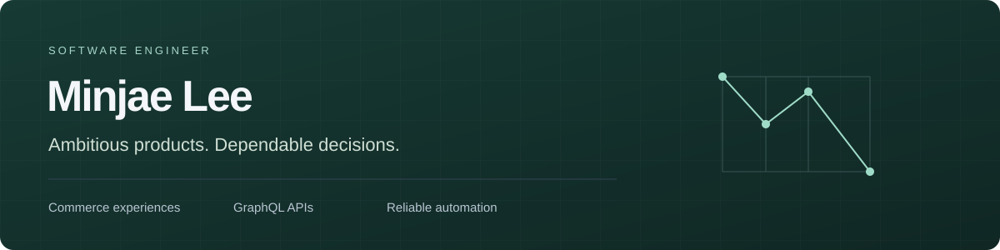

[English](README.md) · [한국어](README.ko.md)

I’m Minjae, a software engineer at NAVER working across commerce experiences, GraphQL API servers and developer productivity. I want ambitious ideas to become products people can depend on.

[LinkedIn](https://www.linkedin.com/in/minjae-lee-kr/) · [Engineering note](https://www.linkedin.com/pulse/when-findings-isnt-enough-coverage-heartbeats-lee-minjae-vre0c/)

### Selected engineering experiments

These are independent implementations with synthetic data. The questions are practical; the limits are explicit.

| Work                  | The question                                                                   | Evidence                                                                                                                        |
| --------------------- | ------------------------------------------------------------------------------ | ------------------------------------------------------------------------------------------------------------------------------- |
| **Intent / Recovery** | After a response disappears, how do we recover the same durable intent?        | Real HTTP response loss, SQLite and process crashes. [Recorded local run](docs/evidence/intent/).                               |
| **Verified Change**   | Did we select the code—and the verification policy—that was actually reviewed? | Immutable Git candidates, real checker processes and conditional ref updates. [Recorded local run](docs/evidence/change/).      |
| **Cancellation Debt** | When the gateway stops waiting, what work still occupies capacity?             | Four policies compare request cancellation, permits and physical completion. [Recorded local run](docs/evidence/cancellation/). |

Public source: [Intent / Recovery](https://github.com/minjae-lee-kr/intent-recovery-lab) · [Verified Change](https://github.com/minjae-lee-kr/verified-change-lab) · [Cancellation Debt](https://github.com/minjae-lee-kr/federated-catalog-lab).

These report bundles are read-only records of local execution, not live services or production claims. To browse the Korean/English portfolio, run `npm start` and open `http://127.0.0.1:4173`. Relative report links above open source folders on GitHub; they are not hosted demos.

A smaller public tool: [**Empty Check Guards**](https://github.com/minjae-lee-kr/empty-check-guards) distinguishes “nothing found” from “nothing checked.”

Three reading guides connect the design decisions to their raw evidence: [When the key outlives the record](docs/notes/retention-boundary/), [Verify what “passed” means](docs/notes/verified-change/) and [The permit returned. The work remained](docs/notes/cancellation-debt/). Each includes Korean and English views and annotated figures.

Intent also includes an [observed-history explorer](docs/evidence/history/): the same final ledger can accompany incompatible reads. It separates actual HTTP observations from one deliberately altered response and one possible sequential explanation.

### How I work

- Connect the user’s intent to client state, API contracts and a durable result.
- Reproduce a plausible failure before claiming the protected path works.
- Keep the source revision, evidence and boundaries close to the claim.

React · TypeScript · GraphQL · Apollo Federation · Node.js · developer automation

All examples are original personal work. They do not reproduce employer code, internal architecture, private data or production results.
